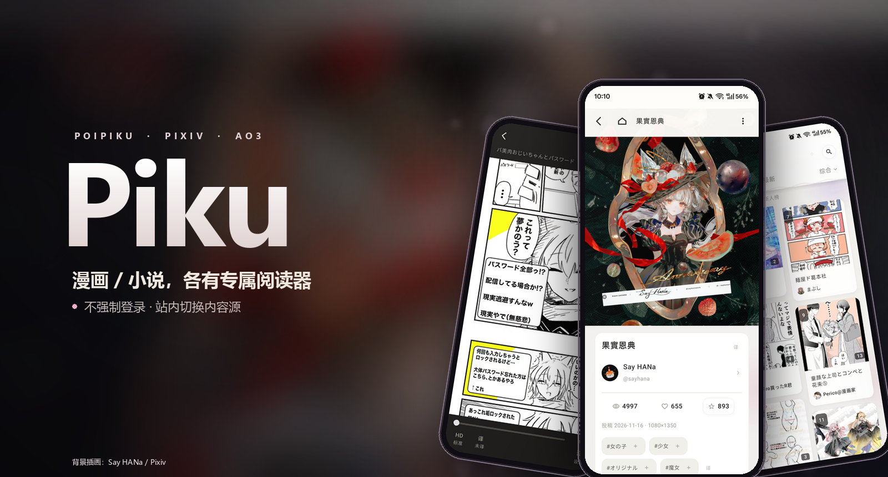
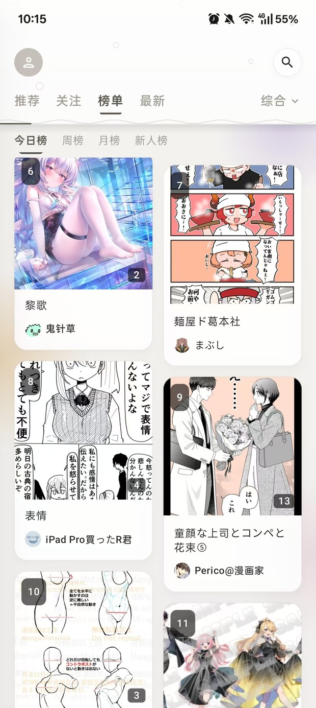
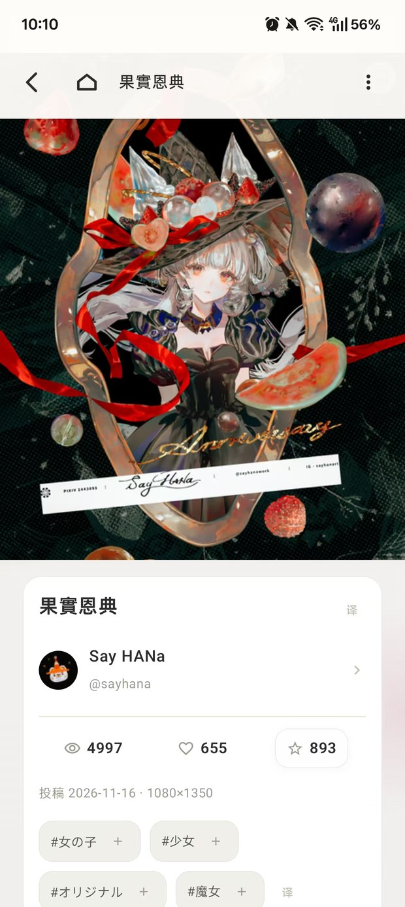
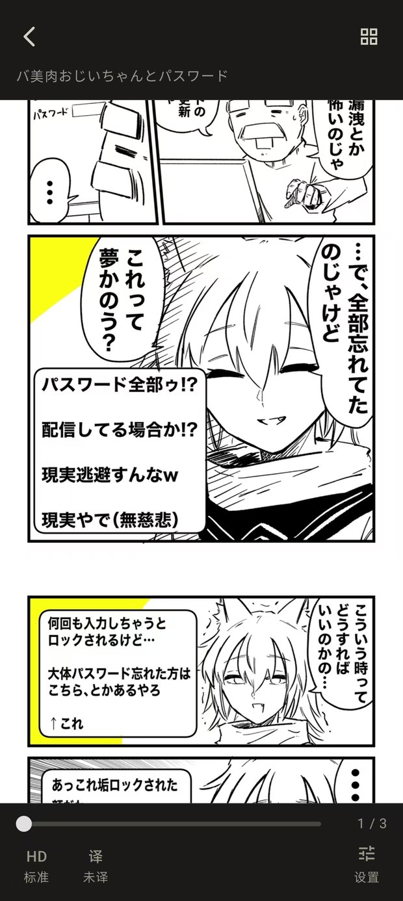
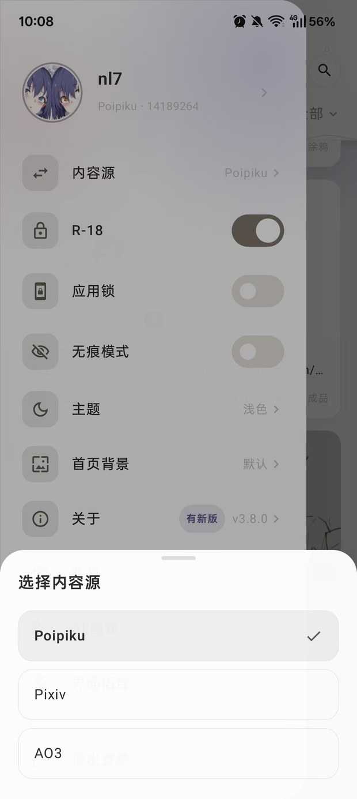

<h1 align="center">Piku</h1>

Poipiku · Pixiv · AO3 站点切换客户端，登录可选

  

<strong>轻量 · 美观 · 体验优先</strong>，不做功能堆砌，只把阅读本身做好。

## 特性

- **不强制登录**：未登录也能浏览、搜索和阅读公开内容，需要账号功能时再登录
- **站内切换内容源**：首页可在 Poipiku、Pixiv、AO3 之间切换，搜索时单独选定站点，结果不跨站混合，不是聚合搜索
- **各源单独适配**：按站点结构分别实现首页流、版式、筛选和作者页（AO3 列表流、Pixiv 榜单与画师主页、Poipiku 原生详情），不是一套模板硬套所有站点
- **专属阅读器**：漫画和小说各有专门的阅读器，而不是同一套通用阅读页
- **离线缓存**：小说支持缓存后离线阅读，并检测章节更新
- **收藏与历史**：多收藏夹管理，支持 Poipiku 书签 / Pixiv 收藏镜像与 WebDAV 同步，历史记录可设置保留时长
- **其他**：AI 翻译、无痕模式

## 截图

| 首页 | 详情 | 阅读器 | 设置 |
| --- | --- | --- | --- |
|  |  |  |  |

## 反馈

欢迎提交 [Issues](https://github.com/NLick47/Piku/issues) 反馈问题或建议

> 免责声明：本项目为 Poipiku、Pixiv、AO3 的非官方客户端，仅用于学习与个人使用，与各平台官方无任何关联，请勿用于商业用途。所有内容版权归各平台及原作者所有
